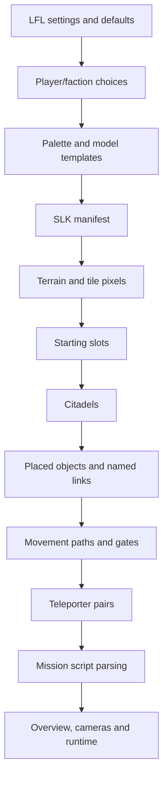

# Loading and files

Status labels used here: **source-confirmed** means traced in the pinned checkout;
**corpus-verified** means checked against the local assets; **open** means not
established. Source references link through the [pinned index](source-index.md).

## Mission entry points

The useful viewer entry point is an LFL mission configuration, with SLK opening
also possible for geometry inspection. A naked SLK does not supply all settings
needed to reproduce a mission's appearance or selected model variants.

| File | Role | Current reader |
| --- | --- | --- |
| `GRIDS/<mission>.lfl` | Names the map, script, briefing; configures environment, palette, sky, AI and technology | [mission-settings](source-index.md#mission-settings) |
| `GRIDS/<map>.slk` | Mixed text/binary terrain plus structured placement sections | [load-order](source-index.md#load-order) |
| `GRIDS/<script>.hzs` | Mission language, conditions, variables, actions | [script-load](source-index.md#script-load) |
| `GRIDS/<briefing>.cam` | Objectives, planet description, ranking, spy information | [briefing](source-index.md#briefing), [campaign-text](source-index.md#campaign-text) |
| `GRIDS/packs/<map>_01.pak` | Indexed 32×32 terrain tiles | [terrain-tiles](source-index.md#terrain-tiles) |
| `GRIDS/palettes/<name>.bmp` | Mission palette | [palette](source-index.md#palette) |
| `GRIDS/skies/<name>*.bmp` | Current port's layered sky artwork | [sky](source-index.md#sky) |
| `GRIDS/gohs/<map>.tga` | Optional strategic overview/minimap artwork | [overview](source-index.md#overview) |
| `GRIDS/depths/<map>.dph` | Terrain-derived packed depth/cache data | [terrain-depth](source-index.md#terrain-depth) |
| `uprising.cln` | Indexed archive containing models, textures, sounds and other resources | [resources](source-index.md#resources) |

The 30 local LFL files all resolve their declared SLK, script, CAM, and palette
dependencies. Names must come from directives, not an assumed common stem.
Case and slash direction vary in the original data.

## Resource resolution

`game_application_load_blob` first attempts the loose filename. Only if that fails
does it look up the resource in the CLN catalog. Model assets and many textures
use this path. `host_file_open` normalizes backslashes and supports ASCII
case-insensitive path recovery on non-Windows hosts.

Two exceptions matter:

1. Level/config/script section readers use `resource_file_open`, which opens a
   host file. This API does not automatically search inside CLN.
2. Terrain PAK loading and the current layered sky loader also use host files.
   Do not assume every filename goes through the blob resolver.

A viewer should preserve the selected asset root, requested path, resolved path,
loose/archive provenance, and fallback reason. It should not silently replace
missing art with a different asset without reporting that decision.

## CLN layout

Source-confirmed by [archive-index](source-index.md#archive-index),
[archive-payload](source-index.md#archive-payload), and [rle](source-index.md#rle).
All integers below are little-endian.

```text
u32 record_count
repeat record_count:
    u32 name_length
    byte[name_length] name
    u32 unpacked_size
    u32 packed_size
    u32 archive_header_offset
```

An index record is usable when its name is nonempty, unpacked size is nonzero,
and header offset is nonzero. Lookup folds ASCII name case. At the referenced
offset, the loader skips a 12-byte header, then reads `packed_size` bytes if
nonzero, otherwise `unpacked_size` bytes. The current loader does not validate
those 12 header bytes; their independent field meanings remain open.

Compression is byte-pair RLE: `(count, value)` repeated, emitting `count` copies
of `value`. It is not ZIP, LZ, or a general PAK container. Packed size must be
even and the sum of counts must equal the declared unpacked size.

Corpus: 2,413 raw records; 2,336 usable normalized names. The latter contain
163 BDM, 1,713 BMP, 421 WAV, 36 SQC, two TXT, and one SDF resource. Every usable
payload's bounds and RLE length were verified. The difference between raw and
usable counts is not a count of missing assets.

## Load sequence

The game performs much more work than a viewer requires. The relevant path is:



[startup](source-index.md#startup) prepares player resources before the level
session. [load-order](source-index.md#load-order) seeks terrain and slots using
the manifest, then chains the returned byte offsets through later sections.
Script loading occurs after static objects and names exist.

The SLK preamble also contains old model-name/type rows between the first three
directives and the terrain offset. The traced session/terrain loaders seek past
these rows; current object construction selects catalog/name tables instead.
Preserve the rows as provenance. Their original tooling purpose has not been
established, and they are not a reliable object-to-model map for this viewer.

## SLK sections

The first three meaningful directives are `SLICK <float>`, `terrain <byte offset>`,
and `slots <byte offset>`. The version parser accepts a float; this is not evidence
that every possible version is supported. Local samples say `SLICK 1.03`.

At the terrain offset: dimension/tile-count line, that many tile-name lines,
then binary data. At the slots offset:

| Section | Record shape |
| --- | --- |
| `slots N` | `x z heading_degrees` |
| `num_citadels N` | `citadel owner footprint_count upgrade_count health`; rectangles; `claim 1`; claim rectangle; `base x z heading`; `upgrades N`; upgrade rows |
| `objects N` | `kind owner x z y heading name attribute parent flags group variant` |
| `movement_paths N` | `name point_count flags`; `x z y` point rows |
| `teleporters N` | `name heading source_x source_z source_y destination_x destination_z destination_y` |

Limits in the current readers: slots 16, citadels 16, footprints per citadel 16,
upgrade slots per citadel 8, placed objects 256, paths 64 with 16 points each,
teleporter pairs 16. These are parser/runtime capacities, not an authoring spec.

Each file has a zero-filled tail after its final parsed section. Every local map
also has 66,050 bytes between the consumed terrain payload and the slots offset.
The traced terrain decoder does not interpret that interval. Its meaning is
**open**; the audit records boundaries rather than guessing an authoring format.
