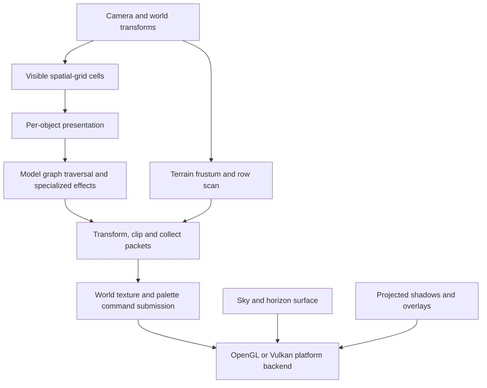

# Scene collection and rendering

The traced rendering path is ordinary native C, but it is still a game pipeline.
Its algorithms and asset structures are useful references; its frame state,
legacy-ID views, and backend bridge are not a ready-made viewer viewport.

## Frame path

[scene-collection](source-index.md#scene-collection) walks selected spatial-grid
cells and their two entity planes. It applies camera/object exclusion rules,
calls the appropriate object's presentation routine, collects overlays, and then
calls the terrain presentation path. This is a visibility-dependent view of the
live scene, not a complete enumeration of the level file's placements.

The player frame in `source/game/level_frame.c` calls the world presentation
collector, optional world/sky surface drawing, the textured world queue, and
colored geometry, then other presentation work. Strategic and remote views have
their own callers. A viewer should not depend on one gameplay camera to discover
all objects, especially objects skipped by player/mode/fog rules.

## Model traversal

[model-submission](source-index.md#model-submission) dispatches special descent
and billboard models separately, then prepares ordinary scene submission state:
camera matrix, clip buffers, visible/shadow queues, projection parameters, palette
view, and presentation policy.

[scene-submission](source-index.md#scene-submission) traverses the owned holder
graph, composes local/world/camera matrices, reads retained mesh topology and
presentation UVs, and submits clipped polygons. It can emit projected bounds or
ground shadows. Render-time UV updates and object-specific transforms are
separate from the immutable asset mesh.

For a viewer, retain decoded meshes and explicit local transforms, derive world
matrices, and let the selected renderer do conventional depth testing and clipping.
Reproduce the game's placement, mesh hierarchy, material and animation semantics
where needed. Importing the CPU screen-space packet representation would carry
camera/frustum assumptions and scratch-state ownership into the new application.

## Terrain collection

`game_level_terrain_present` reads the camera's five-point frustum, constructs edge
streams, and drives a row scan through `gameplay_geometry_render_terrain_frame`.
Grid vertices are emitted with height, flags-driven wave displacement, and light.
Each cell produces two triangles with the descriptor-selected material/UV layout
and parity-selected diagonal. Rows/cells are inserted around the camera split to
preserve painter ordering before later clipping and projection.

The viewer can build a persistent grid mesh instead. Its geometry must still agree
with the alternating triangulation and wrapping rules in
[terrain-and-environment.md](terrain-and-environment.md).

## Command/backend boundary

[render](source-index.md#render) captures frame projection, fog, palette, point
and texture state. It passes `WorldRendererOps` callbacks for begin, material and
texture access, palette updates, render state, polygons, points and NCC tables.

[world-submission](source-index.md#world-submission) consumes owned arena packets;
the caller can also use a bounded legacy-record reader. These are two storage
paths through native code, not an emulation fallback. Material handles resolve
to real texture owners, and textured/colored/projected work have distinct state
requirements. The platform backend ultimately receives ordinary render vertices.

Skies have their own begin/end and layered BMP logic, including fog sampling.
Soldiers, billboards, particles, procedural meshes, transparency and shadows
require presentation behavior beyond reading a model file. A future fidelity
matrix should list each supported class explicitly.

## Confirmed versus unverified

Confirmed by source tracing: collection, graph submission, terrain packet
generation, material/palette callback boundary, and specialized render paths.

The original audit verified map/model parsing only. The subsequent static
accuracy pass executes native lighting, height, gate and pose routines and
exercises the WebGL renderer through desktop/GPU probes. It also captures an
isolated decompiled-game frame and reproduces its camera in the viewer. See
[the accuracy checkpoint](evidence/accuracy-completion.md) for evidence and
remaining limits; this is not a full pixel-parity or performance claim.
