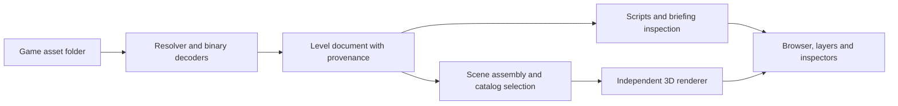

# Viewer boundaries and stack decision inputs

## Established scope

A player-facing viewer for maps, starting positions, units/buildings, paths,
teleporters, environment, briefing, and mission scripting. Editing, saving game
files, mission simulation, and reproducing original authoring tools are outside
the first version. The selected stack is Electron and Three.js WebGL2. Current
behavior is recorded in [UI direction](ui-direction.md) and the
[static accuracy checkpoint](evidence/accuracy-completion.md). The alternatives
and initial milestones below are retained as design history.

Users supply an existing game installation through a folder picker. Initial
script inspection is a read-only text view; objects use static models where
supported and selectable wireframe boxes otherwise. No animations are required.

## What the tracing establishes

- Level geometry and static records can be decoded without game startup.
- The current C parser implementations can be compiled into an isolated research
  harness. All 30 map files match an independent parser's section counts, end
  offsets, dimensions, and decoded height ranges.
- All 163 indexed binary model definitions parse fully under one supported layout
  each. A framework-independent native decoder boundary is practical.
- Native model selection requires catalog/faction/technology information, not just
  the object kind or a filename written in the SLK preamble.
- Some visible entities are sprites, constructed assemblies, or procedural effects.
  “Every object has one BDM mesh” is false.
- Script parsing currently performs gameplay/resource work. A native script-parser
  reuse decision requires more than extracting a lexer function.
- Current rendering is connected to application state, frame queues, bounded legacy
  views, palettes, and backend services. It is not a reusable scene-view widget.

## Proposed reusable boundary

The level document should retain original fields, source file/offset or line,
interpreted coordinates, warnings, dependencies, and asset provenance. Rendered
meshes and GPU textures are derived data. A missing model should not hide a
placement, and a missing optional sky should not prevent reading the briefing.

### Reuse assessment

| Area | Reuse potential | Required separation |
| --- | --- | --- |
| CLN index/RLE, host path behavior | Strong | Asset-root policy, bounded diagnostics and I/O adapters |
| Terrain decoding, tile pixels, mesh decoding | Strong | Backend-neutral pixels/material references |
| Static SLK sections | Grammar reusable | Some modules use singleton active state; citadels/player slots also contain runtime code |
| Model families and catalog constants | Strong reference data | Explicit semantic lookup instead of recreating game-memory manager records |
| BDM scene hierarchy | Strong algorithm reference | Constructor-specific transforms and part visibility |
| SDF fallback | Parser available | Publication/centering/UV transformations; untested asset coverage |
| Mission script parser | Mixed | Source-preserving AST; remove allocations, factories and runtime binding |
| Briefing | Straightforward | Encoding and complete source retention |
| Game renderer | Behavioral reference | Viewer-specific camera, mesh submission, selection, viewport and overlays |

The research harness uses LTO to discard unused runtime functions from mixed
modules. That is evidence of a small parser dependency set, not a proposal to
ship the viewer by linking every game module and relying on dead-code stripping.

## Architecture options and current recommendation

The selected implementation is Electron with Three.js WebGL2 and independent
TypeScript decoders. This supports the agreed map-first interface and text-reading
panels. The first renderer integration and packaged Windows build are validated
in the checkpoint. The comparison below preserves the original audit alternatives.

| Route | What this audit supports | Main work still required |
| --- | --- | --- |
| SDL3 + native UI | Direct C decoder reuse is feasible | Viewer renderer, scene assembly and document/script UI |
| Electron + web 3D + WASM decoder | The stateless C portions have a plausible WASM boundary | Actual WASM build, filesystem adapters, transfer/memory API, browser rendering |
| Electron + TypeScript decoders | Binary layouts are small enough to document precisely | Maintain independent parsing and compare against native fixtures |
| Electron + native helper | Shared C decoding with browser UI is plausible | Packaging, process protocol and asset/scene transfers |

WASM and native-helper integrations were not built. GPU rendering and UI now have
Windows runtime checks; other platforms still require acceptance.
Do not equate “native C is reusable” with “SDL3 is necessarily the best product UI”.
Rich script reading, briefing navigation, and linked inspectors are central to
this viewer and should carry real weight in the decision.

## Initial milestones

1. Review a static mockup of the agreed map-first interface and reading panels.
2. Asset-root selection and level/briefing browsing, with diagnostics.
3. Terrain, palette, sky, free/orbit/top-down cameras, and placement markers.
4. Static models or wireframe boxes, grounding, picking and layers; script text
   browsing with search and line numbers.

The approved mockup and desktop implementation cover these milestones. Supported
placements now use textured static BDM models and frozen directional soldier
sprites. Unavailable assets retain labeled wireframes. See the static model and
soldier checkpoints.

Specialized presentation fidelity, animation and semantic script views are
possible later extensions, not initial acceptance requirements.

### Acceptance evidence

Keep structural parsing and visual validation separate. Use the supplied corpus
reports as data fixtures; then compare selected landmarks in the actual game.
Suggested cases: Anshar for ordinary placements, a training mission for sky
fallback/script references, Circus for teleporter pairs, and maps with nonzero
movement paths/gates. Include scenery, soldier sprites, multipart vehicles,
citadel upgrades, water flags, a missing sky name and explicit `nosky`. Unsupported
presentation classes can use clearly identified wireframe placeholders initially.

Verify tile orientation/diagonal, ground contact, model hierarchy, heading,
faction textures/colors where models are supported, and teleporter altitude.
Script-marker reflection becomes a check only if semantic location links are added.
Opening a level or rendering terrain alone does not establish those results.

## Remaining decisions and acceptance

- Choose target platforms and whether a future browser-only distribution matters.
- Saved campaign/network assignments remain outside the implemented default-slot
  and player-technology previews.
- Verify asset compatibility against a retail installation; the audit used the
  reconstructed game's asset set, including its customized sky replacements.
- Validate the selected renderer beyond Windows and against original game visuals.
- Review source reuse terms and asset distribution. The audited game README says
  there is no project-wide reconstructed-code license selected yet. Refer to its
  third-party notices; do not infer a license from a public repository.

The original terrain-authoring pipeline and the opaque SLK interval remain
research questions. Neither is necessary to implement the agreed read-only viewer.
